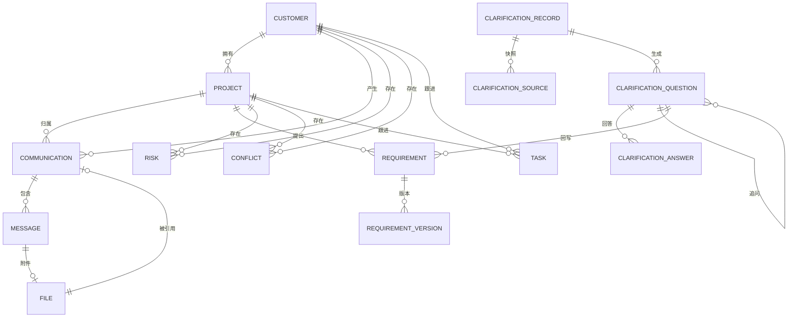
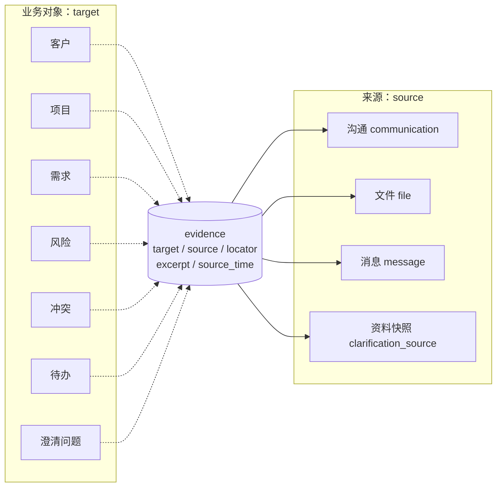

# ClientGraph AI 最小数据字典

> 文档版本：V1.0
> 文档日期：2026-11-06
> 文档状态：设计基线（待并入主 PRD 第 5.3 节）
> 产品简称：ClientGraph AI
> 依据文档：《客户信息聚合工作台》PRD V1.2、《ClientGraph AI 资料输入输出契约》V1.0
> 目标读者：开发实现人员、验收人员

---

## 0. 通用约定

| 项 | 约定 |
|---|---|
| 主键 | 统一 `id TEXT`，UUID v4；不用自增，避免客户合并、数据迁移时冲突 |
| 时间 | 统一 ISO-8601 存储（UTC），界面按 +08:00 展示；`occurred_at` 是业务时间，`created_at` 是入库时间，两者不得混用 |
| 归属 | 用 `customer_id` / `project_id` 表达；可空表示“未归属”，不得用空字符串代替 |
| 来源 | 业务对象必须能追溯到 `source_*_id` 或 `evidence`；AI 生成的必须有证据 |
| 状态 | 枚举值只用本文列出的值，新增状态必须同时补状态迁移规则 |
| 归档 | `archived_at`：业务结束、默认隐藏、可筛选查看、可恢复 |
| 删除 | `deleted_at` 软删除：默认隐藏、可恢复；硬删除仅限误建且无引用 |
| 人工确认 | 三件套 `origin`（ai/human/import）、`review_state`（suggested/pending/confirmed/rejected）、`confirmed_at`；AI 结果不得绕过 |
| 外键 | 一律 `ON DELETE RESTRICT`；级联只在逻辑层做，不用数据库物理级联 |

---

## 1. 实体总览

| # | 实体 | 表名 | 角色 | 核心归属 |
|---|---|---|---|---|
| 1 | 客户 | `customers` | 根实体 | 无 |
| 2 | 项目 | `projects` | 商机/交付单元 | 客户 |
| 3 | 沟通 | `communications` | 一次通话/聊天/邮件/文件导入 | 客户、项目（可空） |
| 4 | 消息/转写片段 | `messages` | 沟通的最小内容单元 | 沟通 |
| 5 | 文件 | `files` | 原始资料 | 沟通（可空） |
| 6 | 需求 | `requirements` | 可跟踪的需求条目 | 项目 |
| 7 | 需求版本 | `requirement_versions` | 需求快照 | 需求 |
| 8 | 风险 | `risks` | 预算/工期/决策/竞品等风险 | 客户或项目 |
| 9 | 冲突 | `conflicts` | 多来源不一致 | 客户、项目（可空） |
| 10 | 待办 | `tasks` | 下一步动作 | 客户/项目（可空） |
| 11 | 澄清单 | `clarification_records` | 一次澄清分析的工作单 | 多客户/项目（快照） |
| 12 | 问题 | `clarification_questions` | 带证据的澄清问题 | 澄清单 + 客户/项目（可空） |
| 13 | 回答 | `clarification_answers` | 甲方回答与回写结果 | 问题 |
| 14 | 证据 | `evidence` | 跨模态引用 | 业务对象 + 来源 |

**支撑表**（不计入 14 个核心实体，但缺一不可）：`clarification_sources` 资料快照、`parse_runs` / `parse_blocks` 解析版本、`ai_results` AI 结果、`match_candidates` 归属候选。

---

## 2. 关系图

### 2.1 主链路（Mermaid）



### 2.2 主链路（纯文本版）

```text
客户 customer
 ├── 项目 project
 │    ├── 沟通 communication ── 消息 message ── 文件 file
 │    ├── 需求 requirement ── 需求版本 requirement_version
 │    ├── 风险 risk
 │    ├── 冲突 conflict
 │    ├── 待办 task
 │    └── 澄清单 clarification_record（通过快照跨客户/项目）
 └── 沟通 / 风险 / 冲突 / 待办（客户级直属）
```

### 2.3 跨模态证据挂接



```text
[客户/项目/需求/风险/冲突/待办/澄清单问题]
                    │ target_type + target_id
                    ▼
              [evidence]
   locator + excerpt + source_time + snapshot_id?
                    │ source_type + source_id
                    ▼
   [沟通] [文件] [消息] [资料快照]
      │        │       │
      ▼        ▼       ▼
   录音/聊天   PDF/OCR  单条消息
   邮件正文   表格/幻灯片 转写片段
```

挂接规则：

1. **一条证据只描述一个片段**，多片段就多条记录；不允许把整段文档塞进一条证据。
2. **证据必须带定位符**，定位符按《资料输入输出契约》3.4 的规则生成；没有定位符的记录不进入 AI 上下文与导出。
3. **证据不拥有归属**，客户/项目从 `target` 继承；跨客户选材时按 target 分区，避免串线。
4. **快照优先**：源文件仍存在则按 locator 跳转，源文件已删则读 `snapshot_id` 指向的文本快照，界面标注“原资料已删除，展示分析时快照”。
5. **唯一性**：`(target_type, target_id, source_type, source_id, locator)` 唯一，防止重复挂同一条证据。

不同模态的挂接示例：

| 模态 | 业务对象 | 来源 | 定位符 |
|---|---|---|---|
| 通话 | 需求/待办/风险 | 沟通(call) + 消息(transcript_segment) | `file://<file_id>#t=1200-4800` |
| 微信 | 需求/风险 | 沟通(wechat) + 消息(chat) | `chat://<comm_id>#msg=<stable_id>` |
| 邮件 | 需求/待办 | 沟通(email) | `mail://<comm_id>#part=text` |
| PDF/扫描件 | 需求/风险 | 文件 + 沟通(file) | `pdf://<file_id>#page=3&char=120-260` |
| Excel | 需求/预算依据 | 文件 + 沟通(file) | `xls://<file_id>#sheet=报价单&cell=B12` |
| PPT | 需求/方案依据 | 文件 + 沟通(file) | `ppt://<file_id>#slide=4` |
| 图片 | 需求/风险 | 文件 + 沟通(file) | `img://<file_id>#bbox=x,y,w,h` |
| 压缩包 | 继承子项 | 子文件 | `zip://<file_id>#entry=<path>!<child>` |
| 澄清单问题 | 问题 | 资料快照 | `snapshot://<source_id>#char=` |

---

## 3. 数据字典

### 3.1 客户 `customers`

| 字段 | 类型 | 必填 | 说明 |
|---|---|---|---|
| id | TEXT | 是 | 主键 |
| name | TEXT | 是 | 姓名/称呼 |
| company | TEXT | 否 | 公司名，不作为客户主体 |
| phone | TEXT | 否 | 归一化 +86 |
| wechat_id | TEXT | 否 | 微信号/唯一标识 |
| wechat_nickname | TEXT | 否 | 昵称 |
| email | TEXT | 否 | 小写归一化 |
| source | TEXT | 否 | 转介绍/微信/电话/邮件/其他 |
| tags | JSON | 否 | 标签数组 |
| profile_json | JSON | 否 | AI 画像（只存结果，不覆盖人工备注） |
| notes | TEXT | 否 | 人工备注 |
| last_contact_at | DATETIME | 否 | 派生字段，由沟通回填 |
| status | TEXT | 是 | active / archived / merged |
| merged_into | TEXT | 否 | 合并后的主客户 |
| origin | TEXT | 是 | manual / import / merge |
| review_state | TEXT | 是 | confirmed（建档）/ pending（导入候选待确认） |
| confirmed_at | DATETIME | 否 | 人工确认时间 |
| created_at / updated_at | DATETIME | 是 | — |
| archived_at / deleted_at | DATETIME | 否 | — |

- **主键**：`id`；**归属**：根实体。
- **来源**：`origin` + 建档时的沟通/文件 ID（记入 `evidence`，target=customer）。
- **删除**：仅软删除；被沟通/项目引用时禁止硬删；合并后副客户置 `merged` 并保留快照与合并日志。
- **人工确认**：合并、改身份状态、把导入候选转正式客户都需 `confirmed_at`。

### 3.2 项目 `projects`

| 字段 | 类型 | 必填 | 说明 |
|---|---|---|---|
| id | TEXT | 是 | 主键 |
| customer_id | TEXT | 是 | 归属客户 |
| name | TEXT | 是 | 项目名 |
| description | TEXT | 否 | 描述 |
| progress_text | TEXT | 否 | 当前进展原文，自由文本 |
| budget_text | TEXT | 否 | 预算原文，不做自动数值化 |
| timeline_text | TEXT | 否 | 时间要求原文 |
| stage_tag | TEXT | 否 | 阶段标签，仅用于筛选 |
| status | TEXT | 是 | active / won / lost / paused / archived |
| progress_review_state | TEXT | 是 | suggested / confirmed |
| confirmed_at | DATETIME | 否 | 进展建议被采纳的时间 |
| created_at / updated_at | DATETIME | 是 | — |
| archived_at / deleted_at | DATETIME | 否 | — |

- **归属**：必须属于一个客户；客户合并时随主客户迁移。
- **删除**：有沟通或需求时只能归档；无子记录才允许软删除。
- **人工确认**：AI 进展建议只写 `progress_review_state=suggested`，采纳后才 `confirmed`。

### 3.3 沟通 `communications`

| 字段 | 类型 | 必填 | 说明 |
|---|---|---|---|
| id | TEXT | 是 | 主键 |
| customer_id | TEXT | 否 | 空 = 待归档 |
| project_id | TEXT | 否 | 可空 |
| channel | TEXT | 是 | call / wechat / email / file / paste |
| direction | TEXT | 否 | inbound / outbound / unknown |
| title | TEXT | 否 | 如“与张三通话 35 分钟” |
| occurred_at | DATETIME | 否 | 业务发生时间 |
| occurred_at_source | TEXT | 否 | message / mail_header / filename / file_mtime / manual |
| occurred_at_confidence | TEXT | 否 | high / medium / low |
| source_file_id | TEXT | 否 | 原始文件 |
| raw_text | TEXT | 否 | 粘贴/导出原文 |
| transcript_result_id | TEXT | 否 | 指向 `ai_results(kind=transcript)` |
| summary_result_id | TEXT | 否 | 指向 `ai_results(kind=summary)` |
| analysis_status | TEXT | 是 | pending / processing / done / failed |
| match_status | TEXT | 是 | matched / pending / unmatched |
| match_basis | TEXT | 否 | phone / email / wechat / manual |
| match_method | TEXT | 否 | exact / suggested |
| match_confirmed_at | DATETIME | 否 | 人工确认归属时间 |
| created_at / updated_at | DATETIME | 是 | — |
| deleted_at | DATETIME | 否 | — |

- **归属**：客户可空表示待归档；项目必须属于同一客户（约束校验）。
- **来源**：`source_file_id` / `raw_text` / `transcript_result_id`，三者至少有一个。
- **删除**：软删除；消息与证据快照不随之删除，澄清单仍可追溯。
- **人工确认**：`match_status=matched` 若来自 `suggested` 必须人工确认；`occurred_at` 为 low 时界面提示可修正。
- **兼容说明**：PRD 原 `summary_json`、`transcript` 字段改为外键指向 AI 层，避免模型结果混入解析层。

### 3.4 消息/转写片段 `messages`

| 字段 | 类型 | 必填 | 说明 |
|---|---|---|---|
| id | TEXT | 是 | 主键 |
| communication_id | TEXT | 是 | 归属沟通 |
| stable_id | TEXT | 否 | 微信 local ID / 邮件 Message-ID / 导出稳定编号 |
| speaker | TEXT | 否 | 原始说话人标识 |
| speaker_role | TEXT | 否 | me / customer / unknown |
| speaker_source | TEXT | 否 | asr / ocr / manual |
| role_confirmed_at | DATETIME | 否 | 人工校正时间 |
| content | TEXT | 是 | 正文 |
| message_type | TEXT | 是 | text / image / voice / file / system |
| start_ms / end_ms | INTEGER | 否 | 音视频定位 |
| ts | DATETIME | 否 | 消息时间 |
| file_id | TEXT | 否 | 附件 |
| parse_warning | TEXT | 否 | 无法解析的行保留原文并标记 |
| created_at / updated_at | DATETIME | 是 | — |
| deleted_at | DATETIME | 否 | — |

- **主键**：`id`；**归属**：必须属于一个沟通。
- **时间**：`ts` 为消息时间，`start_ms/end_ms` 为媒体内位置，两者不互替。
- **删除**：随沟通软删除；单条不单独删除（保留证据完整性）。
- **人工确认**：`speaker_role` 校正写 `speaker_source=manual` 与 `role_confirmed_at`；原文错字校正需记录 `updated_at`。

### 3.5 文件 `files`

| 字段 | 类型 | 必填 | 说明 |
|---|---|---|---|
| id | TEXT | 是 | 主键 |
| sha256 | TEXT | 是 | 内容哈希，唯一 |
| original_name | TEXT | 是 | 原始文件名 |
| mime | TEXT | 否 | MIME |
| size_bytes | INTEGER | 是 | 大小 |
| kind | TEXT | 是 | audio/video/chat/email/pdf/scan/word/excel/ppt/image/archive/text/html/json |
| stored_path | TEXT | 是 | 只读路径 |
| derived_from | TEXT | 否 | 切片/转码/解压来源 |
| parent_file_id | TEXT | 否 | 压缩包子项 |
| communication_id | TEXT | 否 | 归属沟通 |
| import_batch_id | TEXT | 否 | 批次 |
| imported_at | DATETIME | 是 | 导入时间 |
| parse_status | TEXT | 是 | pending/parsing/parsed/partial/failed/unsupported/skipped_duplicate/cancelled |
| parse_run_id | TEXT | 否 | 当前解析版本 |
| ai_status | TEXT | 是 | not_started/queued/running/succeeded/failed/cancelled/skipped |
| manual_customer_id | TEXT | 否 | 手选归属，优先级最高 |
| manual_project_id | TEXT | 否 | 手选归属 |
| archived_at / deleted_at | DATETIME | 否 | — |

- **主键**：`id`；**归属**：沟通可空（待归档或纯文件资料）。
- **不可覆盖**：`stored_path` 只读；`sha256` 变化视为新记录。
- **删除**：软删除保留 30 天可恢复；`derived_from` 子项随父项隐藏。
- **人工确认**：`manual_customer_id` / `manual_project_id` 任何自动匹配都不得覆盖。

### 3.6 需求 `requirements`

| 字段 | 类型 | 必填 | 说明 |
|---|---|---|---|
| id | TEXT | 是 | 主键 |
| project_id | TEXT | 是 | 归属项目 |
| title | TEXT | 是 | 标题 |
| description | TEXT | 否 | 详情 |
| status | TEXT | 是 | 待确认/已确认/已报价/开发中/已完成/已取消 |
| priority | TEXT | 是 | P0/P1/P2/P3 |
| due_text | TEXT | 否 | 时间要求原文 |
| current_version | INTEGER | 是 | 当前版本号 |
| source_communication_id | TEXT | 否 | 来源沟通 |
| source_question_id | TEXT | 否 | 来源澄清问题 |
| source_answer_id | TEXT | 否 | 来源澄清回答（回写时必填） |
| source_excerpt | TEXT | 否 | 原文摘录 |
| priority_source | TEXT | 否 | 优先级来源：requirement_rule / human，不继承问题优先级 |
| origin | TEXT | 是 | ai / human / clarification |
| review_state | TEXT | 是 | pending / confirmed / rejected |
| confirmed_at | DATETIME | 否 | 人工确认时间 |
| created_at / updated_at | DATETIME | 是 | — |
| deleted_at | DATETIME | 否 | — |

- **归属**：必须属于一个项目；跨项目不合并。
- **状态**：新建默认“待确认”（人工直接录入可显式确认）；“已取消”保留历史，不做物理删除。
- **来源**：AI 抽取必须同时写 `source_communication_id` 与 `evidence`；澄清回写写 `source_question_id`、`source_answer_id` 与回答证据。
- **优先级**：P0/P1/P2 由需求自身规则判断，不继承澄清问题优先级；规则见《回答回写 v1.0》。
- **删除**：仅误建且无版本引用时软删；正常结束用“已取消”。
- **人工确认**：待确认→已确认、优先级调整、取消都需 `confirmed_at`。

### 3.7 需求版本 `requirement_versions`

| 字段 | 类型 | 必填 | 说明 |
|---|---|---|---|
| id | TEXT | 是 | 主键 |
| requirement_id | TEXT | 是 | 归属需求 |
| version | INTEGER | 是 | 版本号，从 1 递增 |
| content_json | JSON | 是 | 该版本完整快照 |
| change_reason | TEXT | 否 | 变更原因 |
| source_communication_id | TEXT | 否 | 触发变更的沟通 |
| source_question_id | TEXT | 否 | 触发变更的澄清问题 |
| adopted_at | DATETIME | 否 | 人工采纳时间 |
| created_at | DATETIME | 是 | — |

- **不可变**：只追加，不修改；`(requirement_id, version)` 唯一。
- **归属**：必须属于一个需求；需求被硬删时禁止（需求不允许硬删）。
- **人工确认**：AI 变更建议采纳后才写新版本，`adopted_at` 必填。

### 3.8 风险 `risks`

| 字段 | 类型 | 必填 | 说明 |
|---|---|---|---|
| id | TEXT | 是 | 主键 |
| customer_id | TEXT | 否 | 归属客户 |
| project_id | TEXT | 否 | 归属项目 |
| requirement_id | TEXT | 否 | 关联需求 |
| type | TEXT | 是 | budget/schedule/decision/competitor/technical/compliance |
| title | TEXT | 是 | 风险标题 |
| description | TEXT | 否 | 说明 |
| level | TEXT | 是 | high / medium / low |
| status | TEXT | 是 | open / mitigated / accepted / closed |
| source_communication_id | TEXT | 否 | 来源沟通 |
| source_excerpt | TEXT | 否 | 原文摘录 |
| origin | TEXT | 是 | ai / human |
| review_state | TEXT | 是 | suggested / confirmed / rejected |
| confirmed_at | DATETIME | 否 | 确认时间 |
| created_at / updated_at | DATETIME | 是 | — |
| closed_at | DATETIME | 否 | 关闭时间 |
| deleted_at | DATETIME | 否 | — |

- **归属**：`customer_id` 与 `project_id` 至少一个非空；项目存在时其客户必须一致。
- **来源**：AI 只能建 `suggested`，人工确认后才进入风险视图与提醒。
- **删除**：关闭用 `closed`，不删除；误建才软删。

### 3.9 冲突 `conflicts`

| 字段 | 类型 | 必填 | 说明 |
|---|---|---|---|
| id | TEXT | 是 | 主键 |
| customer_id | TEXT | 是 | 归属客户 |
| project_id | TEXT | 否 | 归属项目 |
| field_name | TEXT | 是 | budget / timeline / scope / decision_maker |
| value_a | TEXT | 是 | 值 A |
| source_a_id | TEXT | 是 | 证据 A 所属沟通/文件 |
| value_b | TEXT | 是 | 值 B |
| source_b_id | TEXT | 是 | 证据 B 所属沟通/文件 |
| status | TEXT | 是 | open / resolved / ignored |
| resolution | TEXT | 否 | a / b / both / ignore |
| resolution_note | TEXT | 否 | 处理说明 |
| resolved_at | DATETIME | 否 | 处理时间 |
| linked_question_id | TEXT | 否 | 关联的澄清冲突问题 |
| created_at / updated_at | DATETIME | 是 | — |

- **归属**：必须有客户；项目可空。
- **来源**：两侧证据缺一不可，否则不建冲突记录。
- **处理**：只能人工裁定，模型不得自动 `resolved`；忽略记 `ignored` 并保留原值。
- **打通**：与澄清单的冲突问题通过 `linked_question_id` 双向关联，避免同一矛盾在两处重复出现。

### 3.10 待办 `tasks`

| 字段 | 类型 | 必填 | 说明 |
|---|---|---|---|
| id | TEXT | 是 | 主键 |
| customer_id | TEXT | 否 | 归属客户 |
| project_id | TEXT | 否 | 归属项目 |
| title | TEXT | 是 | 标题 |
| description | TEXT | 否 | 详情 |
| due_at | DATETIME | 否 | 截止时间 |
| priority | TEXT | 是 | P0–P3 |
| status | TEXT | 是 | todo / doing / done / cancelled |
| source_type | TEXT | 是 | manual / ai_suggested / clarification |
| source_communication_id | TEXT | 否 | 来源沟通 |
| source_clarification_id | TEXT | 否 | 来源澄清单 |
| origin | TEXT | 是 | ai / human |
| review_state | TEXT | 是 | suggested / confirmed |
| confirmed_at | DATETIME | 否 | 采纳时间 |
| created_at | DATETIME | 是 | — |
| completed_at | DATETIME | 否 | 完成时间 |
| postpone_count | INTEGER | 是 | 延期次数，默认 0 |
| deleted_at | DATETIME | 否 | — |

- **归属**：客户/项目可空，允许“个人待办”；项目存在时客户必须一致。
- **来源**：AI 建议在采纳前是 `suggested`，不进今日视图、不发通知。
- **删除**：用 `cancelled`，不删除；逾期不自动关闭。
- **状态**：完成/取消写 `completed_at`；延期只增 `postpone_count` 并更新 `due_at`。

### 3.11 澄清单 `clarification_records`

| 字段 | 类型 | 必填 | 说明 |
|---|---|---|---|
| id | TEXT | 是 | 主键 |
| name | TEXT | 是 | 默认“客户/项目 + 日期”，可改 |
| status | TEXT | 是 | draft/analyzing/partial/incomplete/completed/archived |
| scope_json | JSON | 是 | 选中的客户/项目/未归属范围快照 |
| model_json | JSON | 是 | 本次模型与关键参数快照 |
| language | TEXT | 是 | 默认 zh-CN |
| total_batches | INTEGER | 是 | 分批总数 |
| completed_batches | INTEGER | 是 | 已完成批次数 |
| error_message | TEXT | 否 | 最近失败原因 |
| confirmed_scope_at | DATETIME | 否 | 发送前确认时间 |
| created_at / updated_at | DATETIME | 是 | — |
| archived_at / deleted_at | DATETIME | 否 | — |

- **归属**：不绑定单一客户，归属体现在 `clarification_sources` 与问题分区。
- **状态**：`draft` 草稿；`analyzing` 分析中；`partial` 部分完成（已有部分问题有结论）；`incomplete` 未完成（分析结束但仍有问题未处理，含批次失败）；`completed` 全部问题已回答或不适用；`archived` 归档默认隐藏，可恢复。
- **删除**：只删工作单（软删），原始资料、快照以外的源数据保留；删除前确认。归档与删除都可追溯，归档可恢复。
- **人工确认**：发送分析前必须 `confirmed_scope_at`；回写另计。

### 3.12 问题 `clarification_questions`

| 字段 | 类型 | 必填 | 说明 |
|---|---|---|---|
| id | TEXT | 是 | 主键 |
| record_id | TEXT | 是 | 归属澄清单 |
| customer_id | TEXT | 否 | 结果归属客户，空 = 未归属 |
| project_id | TEXT | 否 | 结果归属项目 |
| category | TEXT | 是 | 10 个固定维度之一 |
| priority | TEXT | 是 | must_confirm / important / later |
| text | TEXT | 是 | 对外问题文本 |
| rationale | TEXT | 否 | 内部提问理由 |
| conclusion_type | TEXT | 是 | fact / inference / unknown（冲突作为独立 conflict 记录，问题侧标 unknown 并保留双方证据） |
| confidence | REAL | 否 | 模型置信度 |
| status | TEXT | 是 | pending / asked / answered / not_applicable / deleted |
| parent_question_id | TEXT | 否 | 追问来源 |
| generated_from | TEXT | 是 | initial / followup / incremental |
| linked_conflict_id | TEXT | 否 | 对应冲突记录 |
| human_edited | INTEGER | 是 | 0/1，人工是否改过 |
| created_at / updated_at | DATETIME | 是 | — |

- **归属**：必须属于一个澄清单；客户/项目可空，空即“未归属”，拆分只改归属不重生成。
- **删除**：`status=deleted` 软删，保留用于指标统计；删除视为处理结论。
- **人工确认**：编辑、调优先级、标不适用、新增自定义问题都置 `human_edited=1`；删除需二次确认。
- **三档优先级**：`must_confirm` 阻塞范围/报价/工期，`important` 影响方案或成本，`later` 可留到交付和运维；判定与置信度规则见《问题优先级-v1.0.md》。

### 3.13 回答 `clarification_answers`

| 字段 | 类型 | 必填 | 说明 |
|---|---|---|---|
| id | TEXT | 是 | 主键 |
| question_id | TEXT | 是 | 归属问题 |
| answer_text | TEXT | 是 | 甲方回答原文 |
| recorded_at | DATETIME | 是 | 录入时间 |
| writeback_state | TEXT | 是 | none / previewed / saved / failed |
| converted_action_json | JSON | 否 | 回写目标与字段变更 |
| created_at | DATETIME | 是 | — |

- **归属**：必须属于一个问题；问题删除后回答保留但隐藏。
- **追加不改**：同一问题多次回答追加新行，界面显示最新并可看历史。
- **人工确认**：回写必须 `previewed` → `saved`；`failed` 可逐项重试，已保存项不回滚。

### 3.14 证据 `evidence`

| 字段 | 类型 | 必填 | 说明 |
|---|---|---|---|
| id | TEXT | 是 | 主键 |
| target_type | TEXT | 是 | customer/project/communication/requirement/requirement_version/risk/conflict/task/clarification_question |
| target_id | TEXT | 是 | 业务对象 ID |
| source_type | TEXT | 是 | communication/file/message/clarification_source |
| source_id | TEXT | 是 | 来源 ID |
| message_id | TEXT | 否 | 精确到消息/片段 |
| locator | TEXT | 是 | 按契约 3.4 生成 |
| excerpt | TEXT | 是 | 原文摘录 |
| source_time | DATETIME | 否 | 来源时间 |
| snapshot_id | TEXT | 否 | 指向 `clarification_sources`，源删除后兜底 |
| verified_by_human | INTEGER | 是 | 0/1，人工是否核对过 |
| created_at | DATETIME | 是 | — |

- **主键**：`id`；**归属**：不单独拥有客户，继承 target。
- **唯一**：`(target_type, target_id, source_type, source_id, locator)` 唯一。
- **删除**：不独立删除；target 软删除时证据保留只读；仅 target 硬删除时逻辑清理。
- **人工确认**：`verified_by_human` 用于“已核对”标记，不阻断使用，但导出与回写只采用已核对或高置信证据。

---

## 4. 支撑表（最小定义）

| 表 | 主键 | 关键字段 | 作用 |
|---|---|---|---|
| `clarification_sources` | id | record_id, source_type, source_id, customer_id, project_id, display_name, text_snapshot, readable, extraction_error, analyzed | 选材快照与增量去重 |
| `parse_runs` | id | file_id, parser_version, status, text_plain, error_code, supersedes_parse_id | 解析版本，重跑不覆盖 |
| `parse_blocks` | id | parse_id, type, text, locator, page/sheet/slide | 结构块与定位 |
| `ai_results` | id | target_type, target_id, kind, status, model, prompt_version, output_json, human_edited | AI 结果版本 |
| `match_candidates` | id | file_id, customer_id, basis, matched_value, method, score | 归属候选 |

---

## 5. 横向规则

### 5.1 删除与归档

| 实体 | 归档 | 软删除 | 硬删除 | 影响 |
|---|---|---|---|---|
| 客户 | 可 | 可 | 禁止（有引用） | 合并保留快照 |
| 项目 | 可 | 仅无子记录 | 禁止 | 有沟通/需求只能归档 |
| 沟通 | 不适用 | 可 | 禁止 | 消息与证据保留 |
| 消息 | 不适用 | 随沟通 | 禁止 | 保证证据完整 |
| 文件 | 可 | 可（30 天） | 需二次确认 | 派生文件随父隐藏 |
| 需求 | 不适用 | 仅误建 | 禁止 | 正常结束用“已取消” |
| 需求版本 | 不适用 | 禁止 | 禁止 | 只追加 |
| 风险 | 不适用 | 可 | 禁止 | 关闭用 closed |
| 冲突 | 不适用 | 禁止 | 禁止 | 用 resolved/ignored |
| 待办 | 不适用 | 可 | 禁止 | 优先用 cancelled |
| 澄清单 | 可 | 可 | 可（确认） | 只删工作单，原件保留 |
| 问题 | 不适用 | `status=deleted` | 禁止 | 保留指标口径 |
| 回答 | 不适用 | 随问题隐藏 | 禁止 | 追加式 |
| 证据 | 不适用 | 随 target 只读 | 禁止 | 快照兜底 |

### 5.2 人工确认点

| 动作 | 确认字段 | 不确认的后果 |
|---|---|---|
| 客户合并 | `confirmed_at` + 合并日志 | 不执行 |
| 归属候选转正式 | `match_confirmed_at` | 停留待归档 |
| 摘要/画像采纳 | `human_edited` / 版本确认 | 仅作建议展示 |
| 需求建档与状态流转 | `review_state` + `confirmed_at` | 保持待确认 |
| 需求变更采纳 | `requirement_versions.adopted_at` | 不生成新版本 |
| 风险确认 | `review_state=confirmed` | 不进风险视图 |
| 冲突裁定 | `resolution` + `resolved_at` | 保持 open |
| 待办采纳 | `review_state=confirmed` | 不进今日视图、不提醒 |
| 澄清发送 | `confirmed_scope_at` | 不调用模型 |
| 澄清回写 | `writeback_state=previewed→saved` | 不写业务表 |
| 证据核对 | `verified_by_human` | 导出/回写优先度降低 |

### 5.3 状态枚举总表

| 实体 | 枚举 |
|---|---|
| 客户 | active / archived / merged |
| 项目 | active / won / lost / paused / archived |
| 沟通 | analysis: pending/processing/done/failed；match: matched/pending/unmatched |
| 文件 | pending/parsing/parsed/partial/failed/unsupported/skipped_duplicate/cancelled |
| 需求 | 待确认/已确认/已报价/开发中/已完成/已取消 |
| 风险 | open / mitigated / accepted / closed |
| 冲突 | open / resolved / ignored |
| 待办 | todo / doing / done / cancelled |
| 澄清单 | draft / analyzing / partial / incomplete / completed / archived |
| 问题 | pending / asked / answered / not_applicable / deleted |
| 回答 | none / previewed / saved / failed |

---

## 6. 完整性约束

1. **无证据不入库**：`requirement`、`risk`、`conflict`、`clarification_question` 的 AI 来源记录必须至少有一条 `evidence`。
2. **归属一致**：`project.customer_id` 必须等于其下沟通/需求/待办的 `customer_id`。
3. **归属唯一**：一条消息只属于一个沟通；一条需求只属于一个项目；一条证据只描述一个片段。
4. **证据唯一**：同一 target 不重复挂同一 locator。
5. **版本单调**：`requirement_versions.version` 从 1 连续递增，`current_version` 等于最大值。
6. **状态单向**：除显式“重新打开”并留日志外，不回退；`completed` 澄清单不因新增资料自动复活，必须走增量分析。
7. **删除不越界**：删除澄清单、软删资料都不删除原始文件与其他业务记录。
8. **AI 只写建议**：`origin=ai` 的记录只能是 `suggested/pending`，`confirmed` 必须有人工确认痕迹。
9. **时间不冒充**：`file_mtime` 推导的时间必须标 `low`，不得显示为“通话时间”。
10. **跨客户不合并**：候选匹配、问题合并、证据汇总都以客户/项目为边界。

---

## 7. 与主 PRD 的差异

| 项 | 主 PRD 现状 | 本字典处理 | 原因 |
|---|---|---|---|
| 风险 | 仅摘要里的 `objections_risks` 与画像文案，无独立表 | 新增 `risks` | 风险需要状态、等级、追踪与提醒，不能只存在于摘要 JSON |
| 证据 | 只有 `clarification_evidence` | 抽为通用 `evidence` + 快照字段 | 需求、风险、冲突、待办都需要跨模态证据 |
| 摘要与转写 | 存在 `communications.summary_json/transcript` | 改指向 `ai_results` | 遵守“解析层/AI 层分离、不覆盖” |
| 冲突 | `conflicts` 与澄清冲突问题两套 | 增加 `linked_question_id` 关联 | 同一矛盾不重复展示 |
| 人工确认 | 零散写在流程里 | 统一 `origin/review_state/confirmed_at` | 可审计、可统计、可阻止 AI 直接写库 |
| 消息 | 无稳定消息 ID | 增加 `stable_id` | 增量导入去重与证据定位需要 |
| 文件 | 无解析版本 | 增加 `parse_run_id`、`derived_from` | 重解析不覆盖、原件只读 |

---

## 8. 自检清单

- [ ] 14 个实体都能回答：主键、归属、时间、来源、状态、删除/归档、确认字段。
- [ ] 每个 AI 产物都能追到至少一条 evidence，且 evidence 能跳回原件位置。
- [ ] 删除或归档任一实体，不会造成孤儿记录或证据断链。
- [ ] 客户合并后，项目/沟通/需求/待办/风险/冲突全部迁移且可追溯。
- [ ] 澄清单删除后，原始资料与历史快照仍可读。
- [ ] 同一客户/项目内重复问题可合并，跨客户绝不合并。
- [ ] 所有 `confirmed` 状态都存在对应的人工确认时间。

---

**文档结束**

> AI生成
