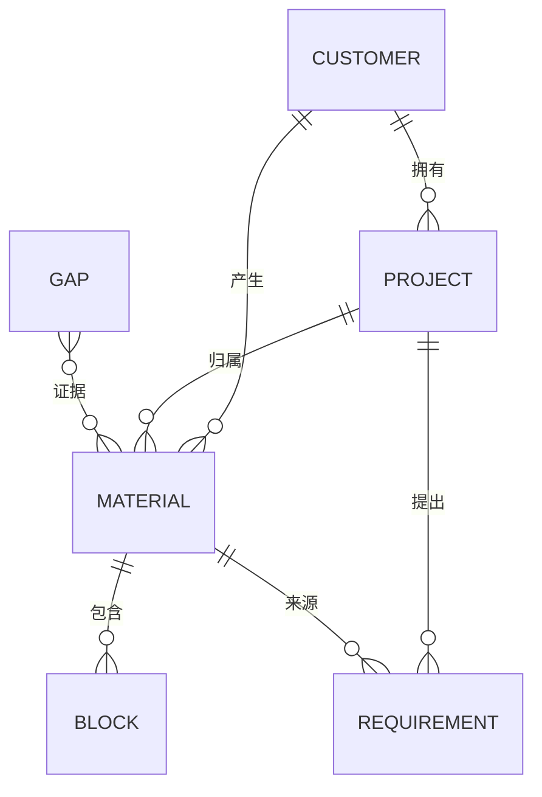

# ClientGraph AI 最小数据字典 v0.1.0

> 日期：2026-11-06
> 适用范围：`prototype/index.html` 的内存数据结构
> 说明：原型只读、无持久化；删除 / 归档字段为后续版本预留，本版本不执行。

## 1. 约定

| 项 | 约定 |
|---|---|
| 主键 | 字符串 ID，客户 `c*`、项目 `p*`、资料 `M*`、片段 `m*b*`、需求 `F*`、缺口 `G*` |
| 归属 | 通过 `customerId` / `projectId` 表达，空值表示未归属（原型中暂无） |
| 时间 | 资料日期 `date` 为业务日期（YYYY-MM-DD）；片段 `at` 为来源内定位（时间点 / 章节 / 单元格） |
| 来源 | 每条结论必须能追到 `materialId + blockId + locator` |
| 状态 | 仅使用本文列出的枚举，新增需同步更新页面与用例 |
| 删除 / 归档 | 原型不提供；字段保留给持久化版本 |
| 人工确认 | 原型不写入，因此没有确认状态；后续版本需补 `origin / review_state / confirmed_at` |

## 2. 实体关系

## 3. 实体定义

### 3.1 客户 Customer

| 字段 | 类型 | 必填 | 说明 |
|---|---|---|---|
| id | string | 是 | 主键，如 `c1` |
| name | string | 是 | 客户名称，演示数据标注“（虚构）” |
| contact | string | 否 | 主要联系人 + 角色 |
| industry | string | 否 | 行业 |
| lastContact | date | 否 | 最近沟通日期 |
| tags | string[] | 否 | 标签，如“重点客户” |

- 归属：根实体；时间：`lastContact` 为派生值；来源：建档沟通（原型未存）。
- 删除 / 归档：不适用；人工确认：不适用。

### 3.2 项目 Project

| 字段 | 类型 | 必填 | 说明 |
|---|---|---|---|
| id | string | 是 | 主键，如 `p1` |
| customerId | string | 是 | 归属客户 |
| name | string | 是 | 项目名 |
| status | enum | 是 | 进行中 / 线索 / 预研 |
| budgetText | string | 否 | 预算原文，不做数值化 |
| dueText | string | 否 | 目标日期或“未定” |
| progress | string | 否 | 当前进展自由文本 |

- 归属：必须属于一个客户；时间：`dueText` 为原文；来源：沟通与文档。
- 删除 / 归档：不适用；人工确认：不适用。

### 3.3 资料 Material

| 字段 | 类型 | 必填 | 说明 |
|---|---|---|---|
| id | string | 是 | 主键，如 `M02` |
| type | enum | 是 | chat / call / email / doc / docx / quote / scan / xlsx / ppt / image |
| title | string | 是 | 资料标题 |
| customerId | string | 是 | 归属客户 |
| projectId | string | 是 | 归属项目 |
| date | date | 是 | 资料日期 |
| locator | string | 是 | 定位前缀，如 `file://M02` |
| blocks | Block[] | 是 | 片段列表 |

- 归属：客户 + 项目；时间：`date`；来源：导入（原型内置）。
- 删除 / 归档：不适用；人工确认：不适用（演示语料已固定）。
- 约束：一条资料的 `projectId` 必须属于同一 `customerId`。

### 3.4 片段 Block

| 字段 | 类型 | 必填 | 说明 |
|---|---|---|---|
| id | string | 是 | 主键，如 `m2b6` |
| materialId | string | 是 | 归属资料（由父数组隐含） |
| at | string | 是 | 来源内定位：时间点 / 章节 / 表名!单元格 / 页码 / OCR |
| text | string | 是 | 原文摘录 |

- 归属：必须属于一份资料；时间：`at` 为来源内位置，不是入库时间。
- 删除 / 归档：不适用；人工确认：不适用。
- 约束：`(materialId, at)` 在演示数据中唯一。

### 3.5 需求 Requirement

| 字段 | 类型 | 必填 | 说明 |
|---|---|---|---|
| id | string | 是 | 主键，如 `F3` |
| projectId | string | 是 | 归属项目 |
| title | string | 是 | 需求标题 |
| status | enum | 是 | 已确认 / 待确认 / 已取消（本期） |
| priority | enum | 是 | P0 / P1 / P2 |
| source | string | 是 | 来源资料 ID |

- 归属：必须属于一个项目；时间：原型未存创建时间；来源：`source` 指向资料。
- 删除 / 归档：取消用状态表达，不删除；人工确认：后续版本补 `confirmed_at`。

### 3.6 缺口 / 冲突 Gap

| 字段 | 类型 | 必填 | 说明 |
|---|---|---|---|
| id | string | 是 | 主键，如 `G1` |
| level | enum | 是 | 必须先确认 / 重要 / 后续确认 |
| title | string | 是 | 一句话描述 |
| detail | string | 是 | 差异说明与影响 |
| ev | string[] | 是 | 证据资料 ID，至少 2 个 |

- 归属：继承证据资料的客户 / 项目；时间：取证据资料日期。
- 状态：原型固化，不提供处理动作；后续版本需 `open / resolved / ignored`。
- 人工确认：原型的 5 项为人工整理结果，不由模型自动判定。

### 3.7 证据引用 EvidenceRef

| 字段 | 类型 | 必填 | 说明 |
|---|---|---|---|
| locator | string | 是 | 完整定位符，如 `chat://M01#09:16` |
| materialId | string | 是 | 来源资料 |
| blockId | string | 是 | 来源片段 |
| sourceTime | string | 否 | 来源时间或位置 |
| excerpt | string | 是 | 原文摘录 |

- 规则：一条引用只描述一个片段；定位符必须可解析到 `资料 + 片段`。
- 原型中由 `material.locator + "#" + block.at` 生成。

### 3.8 引用结果 Citation（运行时，不存储）

| 字段 | 类型 | 说明 |
|---|---|---|
| materialId | string | 命中的资料 |
| blockId | string | 命中的片段 |
| score | number | 检索得分（二元组 + IDF） |

- 生命周期：仅当前页面内存；刷新即清空。
- 排序：得分降序，最多 4 条；低于阈值返回空（未知）。

## 4. 枚举与定位符

| 类别 | 取值 |
|---|---|
| 资料类型 | chat / call / email / doc / docx / quote / scan / xlsx / ppt / image |
| 需求状态 | 已确认 / 待确认 / 已取消（本期） |
| 缺口等级 | 必须先确认 / 重要 / 后续确认 |
| 定位符 | `chat://M01#09:16`、`file://M02#02:10`、`mail://M04#正文`、`doc://M05#第 4 节`、`xls://M08#统计!B3`、`pdf://M07#第 1 页`、`ppt://M09#第 7 页`、`img://M12#OCR` |

## 5. 完整性约束

1. `project.customerId` 必须存在，且资料 / 需求的归属链一致。
2. `block.materialId` 必须存在；`material.blocks` 不得为空。
3. 缺口至少引用 2 份不同资料，否则不成立。
4. 每个引用必须能拼出完整定位符。
5. 需求 `source` 必须指向本仓库内的资料 ID。
6. 原型不写库，因此不存在孤儿记录；持久化版本需补外键与软删除约束。

> AI生成
