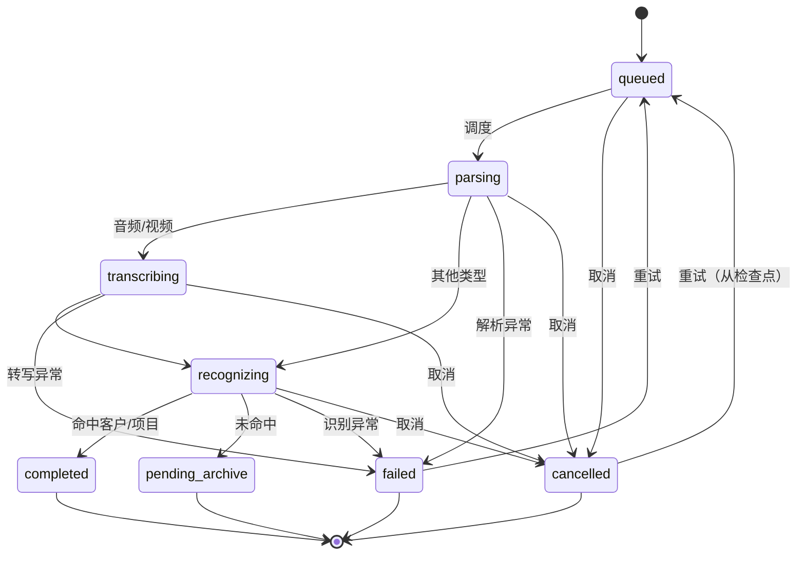

# 导入中心任务模型 v1.0

> 日期：2026-11-06
> 状态：原型实现 + 冒烟验证完成
> 载体：`prototype/index.html` 新增「导入中心」视图
> 范围：单机、单用户、本地任务队列；不含真实文件 IO 与服务端

## 1. 目标

把批量导入拆成**以文件为单位的独立任务**：每个文件有自己的状态、进度、失败原因与重试入口；单个文件失败、取消或应用重启，都不影响其他文件，也不删除原始文件。

## 2. 状态模型

### 2.1 八个状态

| 状态 | 含义 | 进入条件 | 离开条件 |
|---|---|---|---|
| 待处理 `queued` | 已登记，等待调度 | 创建任务、重试、重启恢复 | 被调度 → 解析中；被取消 → 已取消 |
| 解析中 `parsing` | 读取容器/文本/元信息 | 调度到空闲槽位 | 音视频 → 转写中；其他 → 识别中；失败 → 失败 |
| 转写中 `transcribing` | 音轨/视频转写 | 音频、视频解析完成 | 转写完成 → 识别中；失败/取消 |
| 识别中 `recognizing` | OCR、客户/项目匹配、结构化 | 转写完成或非音视频解析完成 | 匹配成功 → 已完成；未匹配 → 待归档 |
| 已完成 `completed` | 处理完成且已归属 | 识别完成且命中客户/项目 | 终态（重试仅对失败/取消开放） |
| 待归档 `pending_archive` | 处理结束但未归属，或格式不支持需人工处理 | 识别完成但无匹配；或无法解析但原件保留 | 终态，等待人工归属 / 处理 |
| 失败 `failed` | 处理失败，保留原因 | 解析/转写/识别异常 | 重试 → 待处理；达到上限后保持失败 |
| 已取消 `cancelled` | 用户取消，保留部分结果 | 用户取消（排队或运行中） | 重试 → 待处理（从检查点继续） |

### 2.2 状态迁移

约束：

- 终态只有 `completed / pending_archive / failed / cancelled`；
- 失败与取消是**可恢复终态**，只能经重试回到 `queued`；
- 不允许从 `completed` 直接重跑，避免重复入库；需要重跑时新建任务（后续版本）。
- 同一任务同一时刻只有一个状态，状态变更必须落盘。

## 3. 任务对象

| 字段 | 类型 | 说明 |
|---|---|---|
| id | string | 任务 ID，如 `F07` |
| name | string | 原始文件名 |
| type | enum | chat / call / audio / video / pdf / scan / docx / xlsx / ppt / image / zip / email / other |
| size | string | 原始大小（展示用） |
| hash | string | 内容哈希，用于去重（原型以 ID 代替） |
| customerId | string? | 预期归属；为空表示应进入待归档 |
| expect | enum | completed / pending_archive，仅决定识别完成后的落点 |
| status | enum | 八状态之一 |
| progress | 0–100 | 单文件独立进度 |
| attempts | number | 已尝试次数，最大 2 |
| maxAttempts | number | 固定 2 |
| error | string? | 失败原因（错误码 + 说明） |
| checkpoint | 0–100 | 取消或崩溃时的进度检查点 |
| cancelRequested | boolean | 取消请求标记，下一拍生效 |
| resumed | boolean | 是否由重启恢复，用于避免重复计次 |
| originalRetained | boolean | 原件保留标记，恒为 true |
| startedAt / finishedAt | timestamp | 开始与结束时间 |
| note | string | 待归档原因、重复文件说明、恢复说明 |

## 4. 进度与阶段

| 类型 | 解析中 | 转写中 | 识别中 | 完成 |
|---|---|---|---|---|
| 音频 / 视频 | 0–25% | 25–70% | 70–99% | 100% |
| 扫描件 / 图片 | 0–20% | — | 20–99% | 100% |
| 聊天 / 邮件 / 文档 / 表格 / PPT / 压缩包 | 0–45% | — | 45–99% | 100% |

- 进度只增不减；取消时冻结在当前位置并写入 `checkpoint`。
- 失败时保留失败点进度（示例 F07 为 35%），便于定位。
- 进度是**任务级**的，不共享、不汇总到单个全局计数器；顶部总进度只是平均值。

## 5. 调度与失败隔离

- 并发上限 2（与产品约束一致），空闲槽位从 `queued` 取任务。
- 每个任务在独立函数中推进；异常被转换为该任务的 `failed`，不向上冒泡。
- 调度循环只读取任务状态，不依赖单任务返回值，因此一个失败不会中断队列。
- 任务完成后立即释放槽位，队列继续。

## 6. 失败原因与重试

| 错误码 | 场景 | 可重试 |
|---|---|---|
| `E_CORRUPT` | 文件损坏、结构非法 | 是（修复原件后） |
| `E_PASSWORD` | 加密未提供密码 | 是（补密码后） |
| `E_ASR_TIMEOUT` | 转写超时 | 是 |
| `E_OCR_LOW` | OCR 置信度过低 | 是 |
| `E_UNSUPPORTED` | 格式不支持 | 否（进入待归档，转人工，原件保留） |
| `E_NETWORK` | 网络中断 | 是 |

规则：

- 最多 2 次尝试；达到上限后按钮禁用，任务保持 `failed`。
- 失败重试从 0 开始；取消后的重试从 `checkpoint` 继续。
- 重试不清空原件、不删除已完成部分、不影响其他任务。
- 失败原因必须包含错误码与可读说明，不能只显示“失败”。

## 7. 取消与检查点

- 排队中取消：立即置 `cancelled`，进度 0。
- 运行中取消：置 `cancelRequested`，下一拍停止，`checkpoint = 当前进度`。
- 取消不删除原件、不清空已完成片段；备注“保留已完成部分与原件”。
- 重试取消任务时从 `checkpoint` 继续，不从头开始。

## 8. 应用重启恢复

- 每次状态变更写入 `localStorage`（键名以代码为准）。
- 启动时读取：处于 `parsing / transcribing / recognizing` 的任务改为 `queued`，标记 `resumed`，保留进度与检查点。
- 已完成、待归档、失败、取消的任务保持不变。
- 若存在未完成任务，显示恢复提示，并在 500ms 后自动续跑。
- 恢复不增加 `attempts`，避免“重启一次算一次重试”。
- 原型的“重启”以浏览器刷新模拟；未验证真实进程崩溃与断电场景。

## 9. 原始文件保留

- 任务创建即登记文件名、大小、哈希与只读标记；失败、取消、重试、重启都不删除。
- 列表中每行固定显示“原件保留”，失败原因中再次提示。
- 原型只保留元数据，不含真实文件；生产实现应保留原件并禁止解析过程回写。
- “重置演示”只重置任务列表与本地存储，不代表删除原件；生产环境需单独定义清理策略与二次确认。

## 10. 批量 20 个文件的验证

### 10.1 用例

一次导入 20 个文件，含 1 个损坏 PDF（F07）、3 个应进入待归档的文件（F05 / F13 / F20）、1 个重复文件（F19）。

### 10.2 独立进度与并发

| 采样时刻 | 活跃任务 | 观察 |
|---|---|---|
| 120ms | F01 解析中 20%，F02 解析中 22% | 两个任务同时推进，进度不同 |
| 600ms | F01 识别中 80%，F02 识别中 88% | 阶段推进独立 |
| 1080ms | F03 转写中 36%，F04 转写中 27% | 音频进入转写阶段，进度不同 |
| 2040ms | F05 转写中 60%，F06 转写中 33% | 队列持续补位 |
| 2520ms | F06 识别中 88%，F07 解析中 12% | 失败文件尚未失败，未阻塞 |
| 3000ms | F08 解析中 36%，F09 解析中 30% | 并发始终 ≤ 2 |

三种运行态均被观察到：`parsing / transcribing / recognizing`；最大并发 2。

### 10.3 单文件失败隔离

| 指标 | 结果 |
|---|---|
| 总数 | 20 |
| 已完成 | 16 |
| 待归档 | 3 |
| 失败 | 1（F07） |
| 已取消 | 0 |
| 其他 19 个任务 | 全部进入 `completed` / `pending_archive` |
| F07 失败点 | 35%，`E_CORRUPT：PDF 结构损坏…` |
| F07 尝试次数 | 1 / 2 |
| 队列阻塞 | 无，后续任务继续调度至全部完成 |

**结论：一个文件失败不会阻塞其他任务。**

### 10.4 重试

- 对 F07 点击重试：`attempts` 变为 2/2，再次在 35% 失败，原因一致；其他任务状态不变。
- 达到上限后重试按钮消失，任务保持失败。

### 10.5 取消与恢复

| 操作 | 结果 |
|---|---|
| 运行到 30% 时取消 F01 | `cancelled`，`checkpoint=30`，原件保留 |
| 其他任务 | 15 完成 / 3 待归档 / 1 失败 / 1 取消，互不影响 |
| 重试 F01 | 从 30% 继续（150ms 后到 50%），最终 `completed`，总数回到 16/3/1 |

### 10.6 重启恢复

| 步骤 | 结果 |
|---|---|
| 启动后 700ms 刷新页面 | 2 个运行中任务被恢复为待处理 |
| 恢复提示 | “检测到 2 个未完成任务，已恢复队列并从检查点继续（原始文件保留）。” |
| 刷新后 900ms | 已完成 2、转写中 2、待处理 16 |
| 最终 | 16 完成 / 3 待归档 / 1 失败 / 0 取消；F07 尝试次数仍为 1（未因重启增加） |

### 10.7 控制台

- 0 error / 0 warning。

## 11. 限制

- 这是**任务模型仿真**：不读取真实文件、不做真实解析/转写/OCR，进度由定时器推进。
- 20 个文件与 1 个失败为固定演示数据；失败注入规则写死（F07 在 35% 失败）。
- 并发固定为 2，不可配置。
- 持久化使用 `localStorage`，容量与可靠性不等同于数据库；仅验证单浏览器。
- “应用重启”用页面刷新模拟，未覆盖进程被杀、断电、磁盘写失败。
- 原件保留在原型中是元数据标记，未做真实文件隔离与只读校验。

> AI生成
